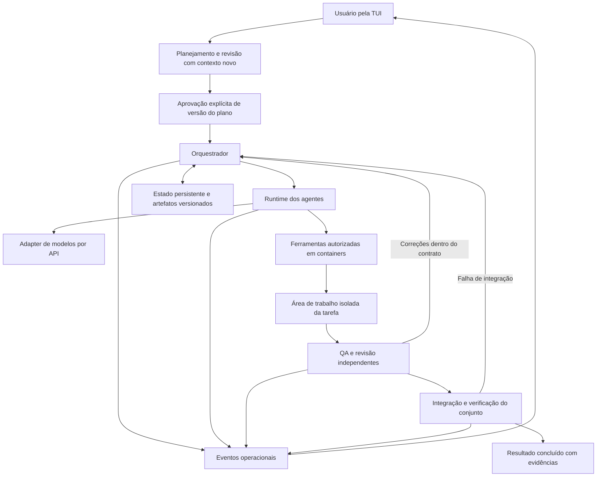

# Arquitetura proposta

Status: arquitetura aprovada e materializada na implementação inicial. Refinamentos técnicos e limites estão em [technical-decisions.md](technical-decisions.md) e [usage.md](usage.md). A validação real de provedores e plataformas adicionais continua pendente.

## Componentes e fluxo



| Componente | Responsabilidade | Não deve assumir |
| --- | --- | --- |
| TUI | Renderizar eventos, receber decisões e enviar comandos ao núcleo. | Estado de tarefas mantido apenas em widgets. |
| Planejamento | Inspeção, entrevista, documentos, tarefas e revisão do plano. | Autorização para implementar enquanto conversa. |
| Orquestrador | Contexto, delegação, dependências, reconciliação e feedback. | Poder de ignorar políticas porque um modelo sugeriu. |
| Políticas e scheduler | Gates, limites, claims e transições verificáveis. | Aprovação deduzida de texto livre. |
| Runtime do agente | Ciclo de modelo, ferramentas, saídas e tentativas. | Ferramentas ou chamadas recursivas sem limite. |
| Adapter de modelos | Chat Completions, streaming, tool calls e uso. | Compatibilidade universal ou fallback silencioso. |
| Executor e workspaces | Containers, comandos, arquivos, isolamento e limpeza. | Acesso irrestrito à máquina ou credenciais. |
| Avaliação | Evidências, critérios, QA e revisão independentes. | Sucesso baseado somente no relato do implementador. |
| Integração Git | Branch compartilhada, commits e validação do conjunto. | Staging de toda alteração presente no checkout. |
| Persistência | Planos, aprovações, tentativas, evidências e eventos. | Gravar segredos ou depender de processos sobreviverem. |

O modelo pode propor prioridades, interpretar resultados e produzir feedback. O código aplica permissões, aprovações, limites e transições. Esses componentes são responsabilidades lógicas, não uma exigência de criar um pacote, processo ou serviço para cada linha.

## Estado e evidências

Entidades propostas: `Project`, `PlanRevision`, `Approval`, `Task`, `TaskContract`, `RoleProfile`, `SkillReference`, `Attempt`, `ToolInvocation`, `Evidence`, `Review`, `Integration` e `Event`.

Uma aprovação referencia a identidade e o conteúdo da revisão, incluindo contratos, configuração relevante, limites, papéis e skills. Hash identifica conteúdo; não autentica por si só quem aprovou. O registro deve distinguir ação do usuário de saídas do modelo.

Fluxo proposto para tarefas:

```text
rascunho → aguardando_aprovacao → pronta → executando → em_validacao
                                                    ↖ corrigindo ↙
em_validacao → pronta_para_integracao → integrando → concluida
```

Bloqueio, pausa, cancelamento e falha precisam de causa registrada e tratamento por fase; não devem ser uma transição global que descarte informação. Dependências só liberam após conclusão válida da versão necessária. Aprovada em QA, mas ainda não integrada, não é tarefa concluída.

Proposta de armazenamento: documentos e contratos locais versionáveis; SQLite para estado operacional e referências a artefatos, com um único dono das transições no núcleo. SQLite está na biblioteca padrão do Python. Não é necessário adotar event sourcing completo: eventos observáveis e histórico de tentativas devem bastar até surgir necessidade demonstrada.

Evidências referenciam critério, comando ou avaliador, versão avaliada, ambiente, horário, código de saída e localização dos resultados. Captura de logs deve preservar o status real e aplicar limites. Evidências de uma versão anterior não aprovam automaticamente alterações novas.

## Artefatos e configuração

Layout implementado:

```text
<projeto>/.kraken/
    project.toml       # configuração sem credenciais
    plan.json          # plano, contratos e dependências; fonte de autoridade
    plan.md            # visualização derivada e revisável
    skills/            # extensões locais com origem e versão
    runtime/           # estado, evidências e logs; fora do versionamento
```

`plan.json` é a fonte única do plano e do backlog. `plan.md` é derivado e não altera a autorização se for editado isoladamente. Glossário e decisões fazem parte do contrato estruturado; documentos adicionais podem ser referências. Perfis de papéis são definidos em `project.toml`, sem duplicar configuração em outro diretório.

A criação desses arquivos no projeto gerenciado deve preservar arquivos existentes, apresentar mudanças e configurar exclusão do estado operacional conscientemente. O checkout do Kraken não foi inicializado como projeto autônomo para executar tarefas reais.

Variáveis implementadas: `OPENAI_BASE_URL`, `OPENAI_API_KEY` e `OPENAI_MODEL` para o perfil padrão, explicitamente lidas pelo Kraken. Não presumir que todo SDK reconhece os três nomes. Overrides por papel usam perfil com endpoint, modelo e nome da variável de credencial, sem o valor secreto. Variáveis específicas de outros provedores podem ser referenciadas pelo perfil. Definir precedência e validação antes de implementar.

Timeouts, concorrência e políticas de repetição são explícitos. Repetir uma chamada após erro pode duplicar consumo; repetir uma ferramenta pode duplicar efeitos. Aplicar idempotência quando possível e reconciliação quando não houver certeza. Não prometer execução exatamente uma vez em todos os serviços externos.

## Harness proposto

1. Preparação reproduzível e verificação de pré-requisitos do projeto.
2. Contexto navegável, contratos autossuficientes e interfaces documentadas.
3. Gates de aprovação, autorização, orçamento e compatibilidade.
4. Ferramentas limitadas, isolamento e observação das operações reais.
5. Verificações apropriadas: tipos, build, testes, comportamento e arquitetura conforme o projeto.
6. QA e revisão independentes, vinculados a critérios e versões.
7. Correções limitadas com feedback que contém evidências.
8. Revalidação na integração, reconciliação após interrupção e preservação do trabalho do usuário.

Esses mecanismos são adaptações do Kraken. O [mapeamento do artigo](harness.md), lido pelo PDF fornecido, distingue princípios da fonte e escolhas próprias. Checklists ou prompts sozinhos não comprovam que os controles funcionam.

## Isolamento e Git

Separar o processo do Kraken, que coordena APIs e estado, dos executores em containers. Revisores e QA não devem receber ferramentas de implementação por herança. Um revisor pode precisar executar verificações, mas isso deve ser autorizado e identificado como tal.

O backend de containers precisa demonstrar mounts restritos, limites, cancelamento, limpeza e política de rede nas plataformas alvo. Não assumir que uma allowlist no arquivo é aplicada pelo container. Container sem rede pode ser um modo viável para etapas com dependências previamente preparadas; etapas que precisam de rede exigem controle implementado e aprovado.

Proposta inicial para áreas de trabalho: cópias Git separadas por tarefa, originadas de uma base identificada. Não criar worktrees automaticamente nesta sessão. O mecanismo definitivo depende da análise de desempenho, armazenamento e preservação do checkout original. Evitar cópia indiscriminada de credenciais e configuração Git pessoal.

Integrações são serializadas. Após conflito ou mudança da base, produzir novo candidato, reaplicar QA/revisão pertinentes e validar o conjunto. O destino automático é apenas a branch de trabalho. Não alterar identidade Git global, descartar alterações do usuário ou executar reset destrutivo para facilitar o fluxo.

## Dependências mínimas

Textual é a dependência de interface aprovada. Avaliar suas dependências transitivas e fixar um conjunto reproduzível quando o projeto for implementado.

| Necessidade | Preferência inicial | Quando justificar dependência |
| --- | --- | --- |
| Concorrência e subprocessos | `asyncio` e biblioteca padrão. | Apenas requisito demonstrado que não seja bem atendido. |
| Tipos de domínio e validação | `dataclasses`, enums e validação explícita. | Esquemas complexos se o custo total de validação manual for maior. |
| Persistência | `sqlite3`, transações e migrações pequenas explícitas. | Não introduzir ORM sem necessidade concreta. |
| Configuração e artefatos | `tomllib`, JSON, `pathlib`, `hashlib`. | Parser adicional somente para formato aprovado que o exija. |
| Git e containers | CLIs estabelecidas, invocadas por argumentos estruturados. | SDK se resolver requisito real de forma mais simples. |
| API de modelos | Spike comparando biblioteca padrão, HTTP cliente e SDK. | Streaming, cancelamento e ferramentas podem justificar um cliente mantido; evitar protocolo frágil para economizar uma dependência. |
| Testes do núcleo | `unittest`, fixtures e provedores controlados como ponto de partida. | Ferramentas extras com benefício demonstrável. |

Para cada nova dependência direta: registrar necessidade, alternativa, benefício, custo de manutenção, licença e impacto transitivo. Distinguir runtime de desenvolvimento. Evitar frameworks de agentes, bancos vetoriais, brokers, servidores e abstrações genéricas antes de necessidade comprovada. Não implementar substitutos complexos de bibliotecas maduras apenas para reduzir a contagem de pacotes.

A implementação inicial usa Python >=3.12, wheel/venv, Textual 8.2.8 e HTTPX 0.28.1. As demais funções usam a biblioteca padrão. A matriz macOS/WSL2 ainda precisa de execução; não confundir disponibilidade do código com suporte validado.

## Referências e limites da pesquisa

- [Symphony SPEC](https://github.com/openai/symphony/blob/main/SPEC.md): scheduler, workspace, reconciliação, observabilidade e distinção entre término do agente e conclusão. Seu runner normativo usa o protocolo Codex app-server; o Kraken criará runtime próprio por API.
- [Elephant/Goldfish](https://github.com/google/elephant-goldfish-model) e [arquitetura](https://github.com/google/elephant-goldfish-model/blob/main/docs/designs/architecture.md): contexto persistente para projeto de especificações e revisores com contexto novo. Aplicar isso também à implementação é adaptação do Kraken. Os nomes dos personagens não serão usados no produto.
- [grill-me](https://github.com/mattpocock/skills/blob/main/skills/productivity/grill-me/SKILL.md), [grill-with-docs](https://github.com/mattpocock/skills/blob/main/skills/engineering/grill-with-docs/SKILL.md) e [domain-modeling](https://github.com/mattpocock/skills/blob/main/skills/engineering/domain-modeling/SKILL.md): entrevista, linguagem compartilhada e decisões documentadas. Na pesquisa, grill-with-docs compunha os procedimentos grilling e domain-modeling; não gerava um backlog completo por si só. O Kraken precisará de decomposição e validação próprias.
- [Harness Engineering](https://martinfowler.com/articles/harness-engineering.html): artigo de Birgitta Böckeler analisado a partir do PDF fornecido pelo usuário. Fonte e mapeamento registrados em [harness.md](harness.md).

URLs apontam para fontes móveis. Na implementação das skills, fixar revisão, registrar origem e conferir a licença. A pesquisa orienta esta proposta; não constitui certificação de compatibilidade com essas implementações.


## Refinamentos da versão 0.2.0

O planejador corrige deficiências técnicas em rodadas limitadas, com revisores independentes em cada revisão. Não altera automaticamente campos de intenção, escopo, exclusões, decisões, imagem, fixtures ou limites. Decisões humanas e esgotamento de rodadas ficam explícitos; aprovação nunca é inferida.

Revisões guardam histórico de tarefas. Contratos inalterados e dependências ainda válidas podem ser candidatos a reuse, sempre reavaliados no novo plano aprovado antes de satisfazer dependências. Mudanças de decisões, exclusões, imagem, fixtures ou glossário invalidam conservadoramente o reuse. Resultados anteriores e suas branches permanecem preservados.

Transferência Git usa journal com commit/base/ref anterior, contexto aprovado e evidências. Atualização da ref usa compare-and-swap. Recuperação só completa fases conhecidas; divergências não são forçadas. Se modelos/skills mudaram e o plano foi novamente aprovado, o candidato exige novas avaliações. Uma transferência pendente não pode ser ocultada por replanejamento.

Os resultados computacionais são normalizados por runner/relatório. O arquivo JUnit tem mount de saída exclusivo e sobrevive ao tmpfs do comando. Não se aproveita relatório de outra execução nem resumo inconsistente.

O catálogo fica fora dos projetos; cada projeto tem lock exclusivo e sessões em diretórios estáveis. Mudar de sessão preserva rascunhos e não move journals/workspaces. O layout antigo permanece legível como sessão legada.

Manifestos TOML usam somente a biblioteca padrão e são parte do snapshot de aprovação. Eles declaram requisitos, não concedem permissões. Conteúdo sem origem declarada não ganha atribuição/licença inventadas.
